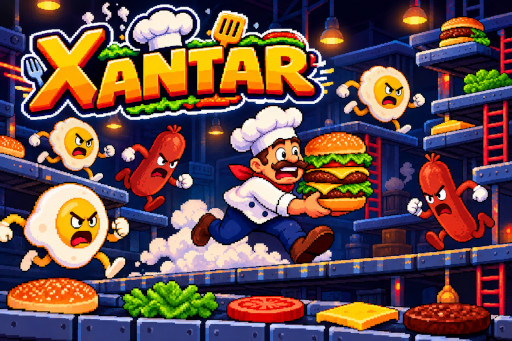

<p align="center">
  
</p>

<h1 align="center">Xantar</h1>

<p align="center"><em>An own take on the classic arcade BurgerTime (Data East, 1982)</em></p>

<p align="center">
  
  
  
  
  <a href="LICENSE.md"></a>
  
</p>

**Xantar** is an arcade game where you control a chef running over
giant burger ingredients. Walking across an ingredient from side to side makes
it fall down the platforms and stack on the plates, eventually building whole
burgers. Meanwhile, anthropomorphic food (hot dogs, onions and eggs) chases
you across walkways and ladders.

It is written in **TypeScript** with the **Phaser** engine and bundled with
**Vite**. The same code runs in the browser and ships as a desktop application
through **Electron** (like VS Code or Discord).

Xantar is under active development towards **version 1.0.0**. The game is in
English and Spanish.

---

## Roadmap

Work is tracked as GitHub issues. The table shows what is already built and what
comes next.

| Status | Feature                                                                                                   | Target | Issue |
| :----: | --------------------------------------------------------------------------------------------------------- | :----: | :---: |
|   ✅   | Playable game: chef, ladders, chain-falling ingredients, three chasing enemies, pepper, scoring and lives |   —    |   —   |
|   ✅   | Title screen and desktop application (Electron)                                                           |   —    |   —   |
|   ✅   | Deterministic simulation core at a fixed 60 Hz step, independent of the renderer and the frame rate       |   —    |  #2   |
|   ✅   | Levels described as data, validated on load, and automated tests of the game rules                        |   —    |  #2   |
|   ✅   | Level model: tile pieces, ingredient segments, navigation graph and validator; turn around mid-ladder     |   —    |  #3   |
|   ✅   | Modern vector visuals: SVG art and side panels                                                            |   —    |  #4   |
|   ✅   | Rendered 3D art for the food and the characters, dancing enemies and a single look                        |   —    |  #37  |
|   ✅   | Game state machine, pause, high score, Spanish and English                                                |   —    |  #5   |
|   ✅   | Ingredients fall like in the original, crush enemies on contact and carry riders two extra floors each    |   —    |  #41  |
|   ✅   | The grid and the first screen of the original: half-chef cells, two-chef burgers, ladders on every side   |   —    |  #45  |
|   ✅   | Enemies walk in from the sides one by one, as in the original, and riders come back where they stopped    |   —    |  #46  |
|   ✅   | Speeds of the original, Easy, Normal and Hard difficulty, and a board won by its last drop                |   —    |  #43  |
|   ✅   | Three more screens of our own in a loop, every screen twice on Easy, and Mr. Onion instead of Mr. Pickle  |   —    |  #49  |
|   ✅   | Gamepad and touch controls, music and sound effects, CI and a hardened desktop app                        |   —    |  #6   |
|   ✅   | Public web version at madialeva.github.io                                                                 |   —    |  #14  |
|   ⬜   | Replay recording and debug tooling                                                                        | v1.0.0 |  #8   |
|   ⬜   | In-game level editor with JSON import/export                                                              | later  |  #7   |
|   ⬜   | Bonus food (ice cream, coffee, fries)                                                                     | later  |  #13  |

---

## How to play

### Goal

Assemble **every burger** on the screen. Each burger has four pieces: bottom
bun, patty, lettuce and top bun. They start spread over the platforms and you
must bring them all the way down to the plate.

When a screen is done the next one comes, and after the fourth the first one
comes back:

1. **Classic**: the first screen of the original arcade game, with eight floors
   at different heights, linked by ladders one to several chefs tall, and four
   burgers that never stand side by side: there is always a ladder on each side
   of a burger, and another one running under it.
2. **Pyramid**: the two top floors only cover the middle burgers, and the
   enemies walk in halfway up.
3. **Counter**: the two middle burgers end on plates halfway down the screen,
   on a counter you can walk under.
4. **Towers**: staggered towers of short floors and double burgers of six
   pieces (two patties and two lettuce leaves) on the last screen before the
   loop.

Screens 2 to 4 are Xantar's own: they follow the way the original gets harder
(more enemies, plates at different heights, taller burgers) without copying its
layouts.

### Starting a game

The title screen waits for a click, a tap or any key, then opens the **main
menu**: **Play** starts a game and **Options** lets you choose the
**difficulty**, the **language** (Spanish or English; the first time it follows
your browser), the **music** and **effects** volumes (left and right change
them; tapping, clicking or confirming one turns it up and, from the top, back to
zero), whether the **sound** is on, and the keyboard **controls**. Your choices
and your **best score** are remembered between sessions. In the desktop app the menu also has
**Quit**, which closes the game; in the browser it has **Quit** when you opened
the game from another page of the same site (such as the home page of the
published game), and it takes you back to that page. Menus work with the arrow
keys and `Enter`, or by clicking or tapping an entry, or with a gamepad; `Esc`
goes back (in the main menu, when there is **Quit**, it selects it).

The **difficulty** sets how fast the enemies go, and it applies to the next game
you start:

- **Easy**: the enemies always go at 85 % of their normal speed, and you play
  **every screen twice** before moving on to the next one, so you can learn
  the game calmly. The level number counts every board you clear.
- **Normal** (the default): as in the original arcade game, the enemies start
  at their normal speed and get a little faster the longer you take on a board,
  with a big push after about a minute; they calm down again on a new board or
  after you lose a life. From level 4 boards start a bit faster.
- **Hard**: the enemies always go at the fastest speed of the original.

### Controls

| Action                       | Keyboard                                     | Gamepad                  | Touch screen               |
| ---------------------------- | -------------------------------------------- | ------------------------ | -------------------------- |
| Move and climb ladders       | Arrows or `W` `A` `S` `D`                    | D-pad or left stick      | On-screen pad (left panel) |
| Throw pepper                 | `Space`                                      | `A` or `X`               | Pepper button (right)      |
| Skip the level clear pause   | `Enter` or `Space`                           | `A`                      | Pepper button              |
| Pause and resume             | `Esc`, `P` or the pause button               | `Start`                  | Pause button               |
| Mute and unmute              | `M`                                          | —                        | —                          |
| Back to the menu (game over) | `Enter`, `Space`, click or tap               | `A`                      | Tap                        |
| Menus                        | Arrows or `W` `S`, `Enter`, `Esc` to go back | D-pad or stick, `A`, `B` | Tap an entry               |

You can **change the keys** in **Options → Controls**: pick an action and a
slot, press the new key (`Esc` cancels, `Backspace` clears the second slot).
Each action has up to two keys; choosing a key that another action uses swaps
them, and **Reset** brings back the defaults. `Esc`, `Enter` and `F11` are
reserved. Gamepads with the standard layout work without setup (press a button
once so the browser shows it); their buttons cannot be changed.

The on-screen pad and pepper button appear as soon as you touch the screen,
and you can walk and throw pepper with two fingers at once. The game is always
played sideways: if you hold the phone upright it turns itself to landscape, so
it works even with the screen rotation locked.

On a ladder you only move while you hold up or down, so you can stop and turn
around anywhere on it. When you reach the height of a platform, press left or
right to step onto it; keep holding up or down and you climb straight on to the
next ladder without stopping.

The game also pauses on its own when its window loses the focus or a gamepad is
disconnected. The pause menu lets you resume or quit to the main menu.

### Ingredients and falls

- Every ingredient is made of **segments** (four in the classic level). When the
  chef **steps on a segment** it is pressed down, and it stays pressed until the
  ingredient falls or you lose a life; the segments pressed before it sink a
  little further, so a half-pressed ingredient tilts. Press all the segments of
  an ingredient and it falls one platform down, slowly and at a steady pace, as
  in the original arcade game.
- When a falling ingredient reaches another one, it **knocks it down too** and
  bounces up for a moment before going on: a chain reaction from the top down
  that only affects the ingredients it actually hits.
- The pieces stack on the plate in the order they arrive, each one with a little
  bounce. By walking over them again, each burger moves down level by level
  until it is complete.
- Every piece is worth **50 points** when it lands.
- You cannot press segments while you are on a ladder.

### Enemies

- **Mr. Hot Dogs** and **Mr. Eggs** roam the maze and chase you using the
  ladders, always taking the shortest way to you. Each screen has its own
  line-up, as in the original: three hot dogs and an egg on the first two
  screens, two hot dogs, two onions and an egg on the third, and four hot dogs
  and two onions on the fourth.
- **Mr. Onion**, a thick slice of red onion, white and violet, joins them on
  later screens. It chases you just like the others and keeps **turning like a
  coin** as it walks and climbs.
- A board starts empty: the enemies **walk in one by one from the sides** of
  the screen, along short walkways at the ends of some floors, and come back
  the same way after you lose a life.
- They are slower than you, as in the original: they walk at about five eighths
  of your pace and climb ladders at half their walking speed.
- If they touch you, you **lose a life**.
- You can **crush them** by dropping an ingredient on top of them. An enemy is
  crushed when the falling ingredient reaches it: one that gets out of the way
  in time escapes, and one that walks under a falling ingredient is crushed.
  They come back after a few seconds, walking in from one of the sides.
- Crushing enemies in a row increases the scoring multiplier, which resets when
  you lose a life.
- **Drop an ingredient with enemies standing on it** and they ride it down: it
  falls two extra floors for every enemy on board (with one enemy, three
  floors), stopping for a moment on each floor and knocking down what it meets.
  While riding they cannot hurt you. When the ingredient lands they are gone
  for a few seconds and you get a bonus; then they come back **right where the
  ingredient stopped** (or on the floor just above the burger if it reached the
  plate), so step away. Stunned enemies ride too, so pepper
  them on an ingredient and then drop it.

### Pepper

- You start with **5 pepper shots**.
- When thrown, the chef creates a cloud in the direction he is facing and
  **stuns** the enemies it touches, so you can walk through them safely.
- On a ladder the pepper goes **up or down**, the way the chef was last
  climbing, so you can stop an enemy coming along the ladder or waiting at
  its end.
- Completing a burger grants one extra shot.

### Scoring

| Action                                 | Points                                          |
| -------------------------------------- | ----------------------------------------------- |
| Drop an ingredient                     | 50                                              |
| Complete a burger                      | 400                                             |
| Crush an enemy                         | 100 × combo                                     |
| Drop an ingredient with enemies riding | 500 for one, doubled for each extra one (1000…) |

### Lives and game over

- You have **3 lives**.
- Every touch from a non-stunned enemy costs a life.
- Every board starts with a short **GET READY!** pause. When an enemy catches
  you, the chef falls, everyone goes back to the start and you get ready again.
  Ingredients that already fell stay where they are, but the ones you had only
  half stepped on are whole again: you have to cross them again from the start.
- Once the ingredients on their way are bound to finish every burger (the last
  one is falling to its plate, or carrying enemies that will take it there), the
  board is won: enemies can no longer take a life. If one catches you then, the
  chef goes down as if he had lost, the enemies freeze and the ingredients keep
  falling; when the last burger is complete he gets back up and you move on to
  the next level with all your lives, as in the original.
- Complete all four burgers to advance to the next level: after a short **LEVEL
  CLEAR!** pause the next screen comes on its own (on Easy, the same screen
  once more), and your score, lives and pepper carry over.
- When you lose every life, **GAME OVER** shows your score and whether it is a
  new best score; confirm to go back to the main menu.

### Sound

The title and menus have music, and the game makes arcade-style sound effects
for pepper, steps, falling and landing ingredients, crushed and stunned enemies,
finished burgers, lost lives, and the start, end of a level and game over. The
effects are synthesized by the game itself. Music and effects have separate
volumes in **Options**, `M` mutes everything at any time, and the sound pauses
while the game is in the background.

### Screen and looks

- The board sits in the middle of the screen, and the score, level, lives
  and pepper shots are shown in **side panels**. On widescreen and 4:3 monitors
  and on phones held sideways the game fills the whole screen; squarer screens
  show bars above and below. The left panel also shows your best score.
- The board keeps the 30 rows of the original, but its floors are a little
  further apart: one run of ladder leaves the chef some room under the floor
  above, so no one ever puts their head through it, and two, three or four runs
  are two, three or four chefs tall.
- The burger ingredients and the characters are **rendered 3D art**: a sesame
  bun, a barbecued patty with grill marks, lettuce and a bottom bun that look
  like real food, a blond chef with a ponytail, and a hot dog, a fried egg and
  a slice of red onion as tall as the chef. The characters are made of separate
  parts that bounce, swing and squash as they move, and each enemy **dances its
  own way** as it walks: the hot dog bends one way and the other, the egg's
  white wobbles and the onion slice turns round and round.
- Finished burgers stack on their plates piece on piece, like real ones.
- The ladders are rendered too, varnished wood with closely spaced rungs; the
  platforms, plates, effects and panels are crisp **vector art**.
- The game looks best on a **Full HD** screen or larger; smaller screens show
  it scaled down.

---

## Where to play

### Browser

Play it online at **https://madialeva.github.io/js/xantar/** (it also opens
from the **GAME** button of https://madialeva.github.io/). Nothing to install:
it works in current desktop and mobile browsers.

The game is a static web application, so it also runs locally:

```sh
npm install
npm run dev
```

Open http://localhost:5173. The production build is generated with
`npm run build` and tested with `npm run preview`.

### Desktop

It can also be packaged as a desktop application with Electron:

```sh
npm install
npm run build:desktop:dir   # unpacked app (fast to launch)
./release/linux-unpacked/xantar
```

To generate installers (AppImage on Linux, `.exe` on Windows, `.dmg` on macOS):

```sh
npm run build:desktop
```

Installers are written to `release/`. Only the format of the host system can be
built locally; the CI builds the three of them (see
[`docs/MANUAL.md`](docs/MANUAL.md)).

In the desktop app, the first click on the title screen switches to fullscreen
and `F11` toggles it at any time. Only one copy of the game runs at a time:
opening it again brings the existing window to the front.

#### Installing an unsigned build

The installers of version 1.0.0 are **not code-signed**, so the operating system
warns before running them:

- **Windows**: SmartScreen shows "Windows protected your PC". Click **More
  info** and then **Run anyway**.
- **macOS**: Gatekeeper says the app cannot be checked. Right-click the app,
  choose **Open** and confirm, or run
  `xattr -dr com.apple.quarantine /Applications/Xantar.app`.
- **Linux**: give the AppImage permission to run
  (`chmod +x Xantar-*.AppImage`) and open it.

---

## Technologies

| Technology           | Use                                   |
| -------------------- | ------------------------------------- |
| **TypeScript**       | Game language (strict typing)         |
| **Phaser 4**         | Game engine (scenes, objects, tweens) |
| **Vite**             | Dev server and web bundling           |
| **Vitest**           | Unit tests of the game rules          |
| **Oxlint**           | Linting with type-aware rules         |
| **Electron**         | Desktop application wrapper           |
| **electron-builder** | Installer generation                  |

---

## Requirements

- **Node.js** 22.12+ (tested with 24).
- A modern browser (Chrome, Firefox, Edge or Safari).
- For desktop packaging, the tooling that belongs to each operating system.

---

## Development

The project supports web and desktop development from the same code:

| Command                     | Description                    |
| --------------------------- | ------------------------------ |
| `npm run dev`               | Web dev server with hot reload |
| `npm run dev:desktop`       | Vite + Electron window         |
| `npm run build`             | Web build into `dist/`         |
| `npm run build:desktop:dir` | Unpacked desktop app           |
| `npm run build:desktop`     | Installers into `release/`     |
| `npm run typecheck`         | Type checking                  |
| `npm run lint` / `format`   | Oxlint and Prettier            |
| `npm run test`              | Unit tests (Vitest)            |
| `npm run smoke`             | Screenshots of the desktop app |

The full technical documentation (architecture, internal mechanics and
workflow) lives in [`docs/MANUAL.md`](docs/MANUAL.md).

---

## License

Released under the **MIT License**. You are free to use, modify, and distribute
this software, including in proprietary projects, provided you retain the
original copyright notice. See [LICENSE.md](LICENSE.md) for details.
