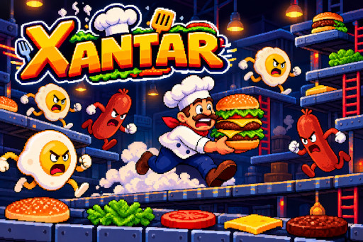

<p align="center">
  
</p>

<h1 align="center">Xantar</h1>

<p align="center"><em>An own take on the classic arcade BurgerTime (Data East, 1982)</em></p>

<p align="center">
  
  
  
  
  <a href="LICENSE.md"></a>
  
</p>

**Xantar** is a single-screen arcade game where you control a chef running over
giant burger ingredients. Walking across an ingredient from side to side makes
it fall down the platforms and stack on the plates, eventually building whole
burgers. Meanwhile, anthropomorphic food (hot dogs, pickles and eggs) chases
you across walkways and ladders.

It is written in **TypeScript** with the **Phaser** engine and bundled with
**Vite**. The same code runs in the browser and ships as a desktop application
through **Electron** (like VS Code or Discord).

Xantar is under active development towards **version 1.0.0**. The game is in
English and Spanish.

---

## Roadmap

Work is tracked as GitHub issues. The table shows what is already built and what
comes next.

| Status | Feature                                                                                                   | Target | Issue |
| :----: | --------------------------------------------------------------------------------------------------------- | :----: | :---: |
|   ✅   | Playable game: chef, ladders, chain-falling ingredients, three chasing enemies, pepper, scoring and lives |   —    |   —   |
|   ✅   | Title screen and desktop application (Electron)                                                           |   —    |   —   |
|   ✅   | Deterministic simulation core at a fixed 60 Hz step, independent of the renderer and the frame rate       |   —    |  #2   |
|   ✅   | Levels described as data, validated on load, and automated tests of the game rules                        |   —    |  #2   |
|   ✅   | Level model: tile pieces, ingredient segments, navigation graph and validator; turn around mid-ladder     |   —    |  #3   |
|   ✅   | Modern vector visuals: SVG art, themes and side panels                                                    |   —    |  #4   |
|   ✅   | Game state machine, pause, high score, Spanish and English                                                |   —    |  #5   |
|   ⬜   | Enemies riding ingredients (an extra level per rider)                                                     | v1.0.0 |  #9   |
|   ⬜   | Gamepad and touch controls, music and sound effects, CI and a hardened desktop app                        | v1.0.0 |  #6   |
|   ⬜   | Replay recording and debug tooling                                                                        | v1.0.0 |  #8   |
|   ⬜   | In-game level editor with JSON import/export                                                              | later  |  #7   |
|   ⬜   | Bonus food (ice cream, coffee, fries)                                                                     | later  |  #13  |
|   ⬜   | Public web deployment                                                                                     | later  |  #14  |

---

## How to play

### Goal

Assemble **every burger** on the screen. Each burger has four pieces: bottom
bun, patty, lettuce and top bun. They start spread over the platforms and you
must bring them all the way down to the plate.

### Starting a game

The title screen waits for a click, a tap or any key, then opens the **main
menu**: **Play** starts a game and **Options** lets you choose the **language**
(Spanish or English; the first time it follows your browser) and the **theme**
(**Automatic** uses the one of each level). Your choices and your **best
score** are remembered between sessions. In the desktop app the menu also has
**Quit**, which closes the game. Menus work with the arrow keys and `Enter`, or
by clicking or tapping an entry; `Esc` goes back (in the main menu of the
desktop app it selects **Quit**).

### Controls

| Action                       | Key                                         |
| ---------------------------- | ------------------------------------------- |
| Move                         | Left/right arrows                           |
| Climb up and down ladders    | Up/down arrows                              |
| Throw pepper                 | `Space`                                     |
| Skip the level clear pause   | `Enter` or `Space`                          |
| Pause and resume             | `Esc`, `P` or the pause button in the panel |
| Back to the menu (game over) | `Enter`, `Space`, click or tap              |

You can also play with the `W`, `A`, `S`, `D` keys. On a ladder you only move
while you hold up or down, so you can stop and turn around anywhere on it. When
you reach the height of a platform, press left or right to step onto it.

The game also pauses on its own when its window loses the focus. The pause menu
lets you resume or quit to the main menu.

### Ingredients and falls

- Every ingredient is made of **segments** (four in the classic level). When the
  chef **steps on a segment** it is pressed down, and it stays pressed. Press all
  the segments of an ingredient and it falls one platform down.
- An ingredient that lands on another one **knocks it down too**: a chain
  reaction that only affects the ingredients it actually hits.
- The pieces stack on the plate in the order they land. By walking over them
  again, each burger moves down level by level until it is complete.
- Every piece that falls is worth **50 points**.
- You cannot press segments while you are on a ladder.

### Enemies

- **Mr. Hot Dog**, **Mr. Pickle** and **Mr. Egg** roam the maze and chase you
  using the ladders, always taking the shortest way to you.
- If they touch you, you **lose a life**.
- You can **crush them** by dropping an ingredient on top of them. They respawn
  after a few seconds.
- Crushing enemies in a row increases the scoring multiplier, which resets when
  you lose a life.

### Pepper

- You start with **5 pepper shots**.
- When thrown, the chef creates a cloud in the direction he is facing and
  **stuns** the enemies it touches, so you can walk through them safely.
- Completing a burger grants one extra shot.

### Scoring

| Action             | Points      |
| ------------------ | ----------- |
| Drop an ingredient | 50          |
| Complete a burger  | 400         |
| Crush an enemy     | 100 × combo |

### Lives and game over

- You have **3 lives**.
- Every touch from a non-stunned enemy costs a life.
- Every board starts with a short **GET READY!** pause. When an enemy catches
  you, the chef falls, everyone goes back to the start and you get ready again;
  the ingredients stay as they were.
- Complete all four burgers to advance to the next level: after a short **LEVEL
  CLEAR!** pause the board is rebuilt on its own, and your score, lives and
  pepper carry over (every level uses the same layout for now).
- When you lose every life, **GAME OVER** shows your score and whether it is a
  new best score; confirm to go back to the main menu.

### Screen and looks

- The 20×15 board sits in the middle of the screen, and the score, level, lives
  and pepper shots are shown in **side panels**. On widescreen monitors and on
  phones held sideways the game fills the whole screen; narrower screens show
  bars above and below. The left panel also shows your best score.
- Everything is drawn from **vector art**, so it stays sharp at any size. The
  characters are made of separate parts that bounce, swing and squash as they
  move.
- The game comes with two **themes**: `classic` and `midnight` (a night-blue,
  neon look). Each level says which theme it uses, and you can force one in
  **Options**; in the browser version you can also add `?theme=midnight` to the
  address.

---

## Where to play

### Browser

The game is a static web application. For now it runs locally:

```sh
npm install
npm run dev
```

Open http://localhost:5173. The production build is generated with
`npm run build` and tested with `npm run preview`.

### Desktop

It can also be packaged as a desktop application with Electron:

```sh
npm install
npm run build:desktop:dir   # unpacked app (fast to launch)
./release/linux-unpacked/xantar
```

To generate installers (AppImage on Linux, `.exe` on Windows, `.dmg` on macOS):

```sh
npm run build:desktop
```

Installers are written to `release/`. Only the format of the host system can be
built locally; the CI builds the three of them (see
[`docs/MANUAL.md`](docs/MANUAL.md)).

In the desktop app, the first click on the title screen switches to fullscreen
and `F11` toggles it at any time. Only one copy of the game runs at a time:
opening it again brings the existing window to the front.

#### Installing an unsigned build

The installers of version 1.0.0 are **not code-signed**, so the operating system
warns before running them:

- **Windows**: SmartScreen shows "Windows protected your PC". Click **More
  info** and then **Run anyway**.
- **macOS**: Gatekeeper says the app cannot be checked. Right-click the app,
  choose **Open** and confirm, or run
  `xattr -dr com.apple.quarantine /Applications/Xantar.app`.
- **Linux**: give the AppImage permission to run
  (`chmod +x Xantar-*.AppImage`) and open it.

---

## Technologies

| Technology           | Use                                   |
| -------------------- | ------------------------------------- |
| **TypeScript**       | Game language (strict typing)         |
| **Phaser 4**         | Game engine (scenes, objects, tweens) |
| **Vite**             | Dev server and web bundling           |
| **Vitest**           | Unit tests of the game rules          |
| **Oxlint**           | Linting with type-aware rules         |
| **Electron**         | Desktop application wrapper           |
| **electron-builder** | Installer generation                  |

---

## Requirements

- **Node.js** 22.12+ (tested with 24).
- A modern browser (Chrome, Firefox, Edge or Safari).
- For desktop packaging, the tooling that belongs to each operating system.

---

## Development

The project supports web and desktop development from the same code:

| Command                     | Description                    |
| --------------------------- | ------------------------------ |
| `npm run dev`               | Web dev server with hot reload |
| `npm run dev:desktop`       | Vite + Electron window         |
| `npm run build`             | Web build into `dist/`         |
| `npm run build:desktop:dir` | Unpacked desktop app           |
| `npm run build:desktop`     | Installers into `release/`     |
| `npm run typecheck`         | Type checking                  |
| `npm run lint` / `format`   | Oxlint and Prettier            |
| `npm run test`              | Unit tests (Vitest)            |
| `npm run smoke`             | Screenshots of the desktop app |

The full technical documentation (architecture, internal mechanics and
workflow) lives in [`docs/MANUAL.md`](docs/MANUAL.md).

---

## License

Released under the **MIT License**. You are free to use, modify, and distribute
this software, including in proprietary projects, provided you retain the
original copyright notice. See [LICENSE.md](LICENSE.md) for details.
